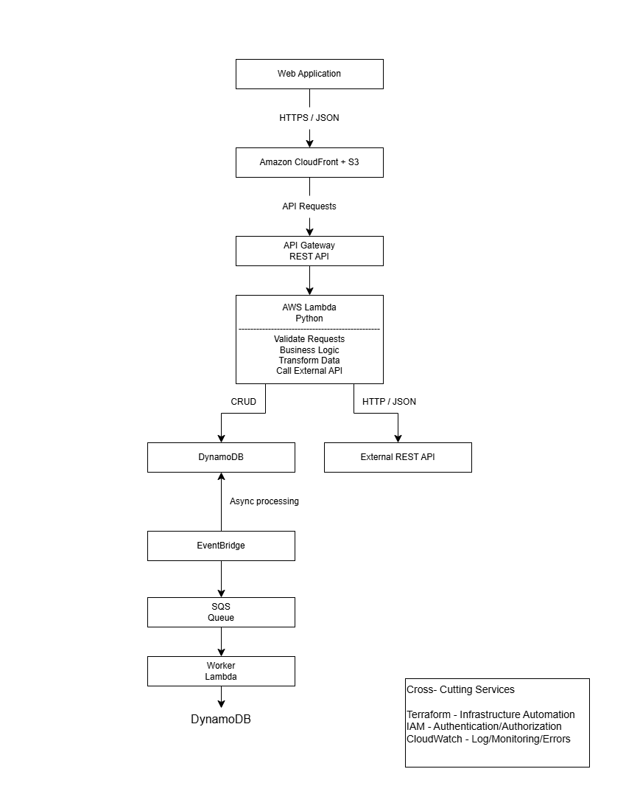

# Service Request Tracker

A serverless service request management application built with AWS. The
project demonstrates REST API development, persistent storage, external
API integration, asynchronous event processing, basic monitoring, and
static frontend hosting.

> **Status:** The core application, external API integration,
> asynchronous workflow, foundational security/observability, and
> frontend hosting have been implemented and tested. Terraform migration
> and final end-to-end documentation are in progress.

## Contents

-   [Overview](#overview)
-   [Architecture](#architecture)
-   [AWS Resources](#aws-resources)
-   [Features](#features)
-   [API Routes](#api-routes)
-   [Asynchronous Workflow](#asynchronous-workflow)
-   [External API Integration](#external-api-integration)
-   [Security and Monitoring](#security-and-monitoring)
-   [Testing](#testing)
-   [Known Limitations](#known-limitations)
-   [Terraform Migration](#terraform-migration)
-   [Local Development](#local-development)
-   [Cost Awareness](#cost-awareness)

## Overview

The Service Request Tracker lets users create, view, update, and delete
service requests through a browser-based interface. The frontend calls
an Amazon API Gateway HTTP API. AWS Lambda handles requests, Amazon
DynamoDB stores request data, and Amazon EventBridge publishes creation
events for asynchronous processing through Amazon SQS and a worker
Lambda.

The infrastructure was initially built and tested manually in the AWS
Console. Terraform is being used to bring the existing resources under
Infrastructure as Code management.

**AWS Region:** `ap-southeast-1` (Singapore)

## Architecture



### Hosted endpoints

-   **Frontend:** https://d2c9bn1eiwxujd.cloudfront.net
-   **API base URL:**
    https://00vsph4f6g.execute-api.ap-southeast-1.amazonaws.com
-   **External API route:** `GET /external-post`

These endpoints reflect the environment recorded during development.
Verify they remain active before relying on them.

## AWS Resources

  ---------------------------------------------------------------------------------------
  Service                 Resource                                Purpose
  ----------------------- --------------------------------------- -----------------------
  Amazon S3               `p4-service-request-frontend-1052313`   Stores frontend files

  Amazon CloudFront       `d2c9bn1eiwxujd.cloudfront.net`         Serves the frontend
                                                                  over HTTPS

  API Gateway HTTP API    `p4serviceRequestAPI`                   Exposes the API

  AWS Lambda              `myServiceRequestFunction`              CRUD handler and
                                                                  EventBridge publisher

  Amazon DynamoDB         `p4-service-request-table`              Stores service requests

  AWS Lambda              `p4ExternalApiIntegration`              Calls JSONPlaceholder

  Amazon EventBridge      `p4-service-request-bus`                Receives application
                                                                  events

  EventBridge rule        `p4-service-request-created-rule`       Routes matching events
                                                                  to SQS

  Amazon SQS              Processing queue                        Buffers asynchronous
                                                                  events

  Amazon SQS              `p4-service-request-dlq`                Holds repeatedly
                                                                  failing messages

  AWS Lambda              `p4ServiceRequestWorker`                Processes messages and
                                                                  writes structured logs

  Amazon CloudWatch       Log groups and alarms                   Monitoring and
                                                                  troubleshooting

  AWS IAM                 Roles and policies                      Controls AWS service
                                                                  permissions
  ---------------------------------------------------------------------------------------

**Queue naming note:** The project notes use both
`p4-service-request-processing` and `p4-service-request-queue` for the
main queue. Confirm the current queue name and ARN in AWS before
importing or modifying it with Terraform.

## Features

-   Create, list, retrieve, edit, and delete service requests.
-   Persist request data in DynamoDB.
-   Publish `Service Request Created` events.
-   Process events asynchronously using EventBridge, SQS, and a worker
    Lambda.
-   Call an external REST API through a separate Lambda.
-   Retry failed SQS processing and route repeatedly failing messages to
    a dead-letter queue.
-   Host static frontend assets using S3 and CloudFront.

The frontend is organized into `index.html`, `styles.css`, `data.js`,
`api.js`, and `app.js`.

## API Routes

Base URL:

``` text
https://00vsph4f6g.execute-api.ap-southeast-1.amazonaws.com
```

  Method     Route              Purpose
  ---------- ------------------ -----------------------------------
  `GET`      `/requests`        List requests
  `GET`      `/requests/{id}`   Retrieve one request
  `POST`     `/requests`        Create a request
  `PUT`      `/requests/{id}`   Update a request
  `DELETE`   `/requests/{id}`   Delete a request
  `GET`      `/external-post`   Call the external API integration

The HTTP API uses a `$default` stage with automatic deployment,
according to the project notes.

## Asynchronous Workflow

When a request is created, the main Lambda saves it to DynamoDB and
publishes a `Service Request Created` event to `p4-service-request-bus`.
The EventBridge rule `p4-service-request-created-rule` matches events
with this pattern:

``` json
{
  "source": ["p4.service-request"],
  "detail-type": ["Service Request Created"]
}
```

The matching event is delivered to SQS. The worker Lambda parses the SQS
message body and supports both direct messages and EventBridge events
containing a `detail` object. It logs structured details for processed
requests.

The main queue uses a 30-second visibility timeout and a redrive policy
that moves messages to `p4-service-request-dlq` after three receives. A
malformed-message test confirmed that repeatedly failing messages
reached the DLQ.

## External API Integration

The `p4ExternalApiIntegration` Lambda calls:

`https://jsonplaceholder.typicode.com/posts/1`

It uses Python's standard-library `urllib.request`, parses the JSON
response, and extracts `userId`, `id`, `title`, and `body`. HTTP errors,
URL/connection errors, timeouts, invalid JSON, and unexpected response
fields are handled; documented failure tests returned HTTP `502`.

**Verification note:** The endpoint was temporarily changed during
failure testing. Verify that the deployed Lambda URL is restored to
`/posts/1` before relying on the integration.

## Security and Monitoring

The project includes:

-   IAM roles and policies for the application, external integration,
    and worker Lambdas.
-   DynamoDB access scoped to the application table.
-   `events:PutEvents` permission scoped to the custom EventBridge bus.
-   SQS permissions for the worker.
-   S3 public access blocking and a CloudFront Origin Access Control
    (OAC) setup.
-   API Gateway CORS restricted to
    `https://d2c9bn1eiwxujd.cloudfront.net`.
-   CloudWatch log groups and two alarms: `p4-worker-lambda-errors` and
    `p4-sqs-message-backlog`.
-   An SQS dead-letter queue for repeated processing failures.

The documented CORS configuration allows `GET`, `POST`, `PUT`, `DELETE`,
and `OPTIONS`, with the `content-type` header and credentials disabled.
CORS is not authentication or authorization.

The alarms were created and observed in the `OK` state, but the project
notes state that no SNS notifications or other alarm actions were
configured. These controls are foundational and do not represent a
complete security audit or production-readiness assessment.

## Testing

The project notes record these successful tests:

-   [x] Frontend CRUD operations against AWS
-   [x] DynamoDB persistence
-   [x] External API success response
-   [x] External API HTTP-error handling
-   [x] External API connection-error handling
-   [x] Worker Lambda manual test
-   [x] SQS-triggered worker test
-   [x] EventBridge rule matching and delivery
-   [x] Frontend → DynamoDB and EventBridge → SQS → worker workflow
-   [x] DLQ behavior after repeated processing failures
-   [x] Hosted CloudFront frontend CRUD tests
-   [x] CORS restriction to the hosted frontend origin

These tests cover the documented flows; they are not exhaustive load,
resilience, security, or production-readiness tests.

## Known Limitations

-   The `PUT /requests/{id}` handler can overwrite omitted fields with
    empty strings or defaults. Partial updates should preserve fields
    that are not supplied.
-   A request can be saved to DynamoDB while EventBridge publishing
    fails. The current behavior logs the publishing error but may still
    return a successful creation response, so an event may be missed.
-   CloudWatch alarm notification actions are not configured.
-   IAM policies and trust relationships need a more complete review.
-   The deployed external API URL should be verified after temporary
    failure tests.
-   The exact SQS processing queue name must be confirmed before
    Terraform import.
-   Terraform reconciliation and final end-to-end verification remain in
    progress.

## Terraform Migration

### Previous approach: CLI-based import

The initial Terraform migration used the older command-based workflow,
running `terraform import` for individual resources after defining their
Terraform resource blocks. For example:

``` powershell
terraform import aws_s3_bucket.frontend p4-service-request-frontend-1052313
```

This imports an existing resource into Terraform state. It does not
create the AWS bucket.

### Recommendation: use declarative `import` blocks

For a more reviewable, code-based migration, it is recommended that the
project use Terraform's declarative `import` blocks instead of relying
on a sequence of CLI `terraform import` commands.

Example resource configuration in `s3.tf`:

``` hcl
resource "aws_s3_bucket" "frontend" {
  bucket = "p4-service-request-frontend-1052313"
}
```

Example import declaration in `imports.tf`:

``` hcl
import {
  to = aws_s3_bucket.frontend
  id = "p4-service-request-frontend-1052313"
}
```

Initialize and review the plan:

``` powershell
terraform init
terraform plan
```

Apply only after reviewing the proposed import and any other changes:

``` powershell
terraform apply
```

An import block does not automatically generate a complete resource
configuration or guarantee a zero-change plan. Existing settings must
still be represented accurately, and unexpected changes should be
investigated before applying.

### Migration safety

-   Back up the existing Terraform directory and state before resetting
    the migration.
-   Use a clean working directory and a new state for the reset.
-   Do not copy the old state file or `.terraform` directory into the
    new workspace.
-   Import existing resources rather than creating duplicates.
-   Review every plan before applying.
-   Do not run `terraform destroy` as part of this migration.
-   Avoid managing the same AWS resources concurrently from two
    authoritative Terraform states.
-   Investigate the previously observed CloudFront origin diff before
    applying changes to the distribution.
-   Keep Terraform state and other sensitive artifacts out of public
    version control.

The goal is to bring the existing infrastructure under Terraform
management without deleting or rebuilding the deployed AWS resources.

## Local Development

Run a local HTTP server from the frontend directory:

``` powershell
cd "C:\Users\Amboy\Desktop\Cloud Career\Advanced Cloud Projects\Project 4\p4-webapp"
python -m http.server 8000
```

Then open `http://localhost:8000` in a browser. Serving the frontend
over HTTP avoids the browser-origin issues encountered when opening the
HTML file directly through `file://`.

## Project Structure

``` text
p4-webapp/
├── index.html
├── styles.css
├── data.js
├── api.js
└── app.js
```

The Terraform workspace is being reset for a declarative import-block
migration. Infrastructure definitions can be grouped by service or
responsibility, with import declarations in a dedicated `imports.tf`
file.

## Cost Awareness

AWS services used by this project may incur charges, including Lambda,
API Gateway, DynamoDB, SQS, CloudWatch, S3, and CloudFront.

Review billing and deployed resources before stopping the project. Do
not remove resources blindly, as changes can interrupt the hosted
application or asynchronous workflow. If cleaning up the environment,
plan and verify the steps for each service.

------------------------------------------------------------------------

## Summary

The Service Request Tracker demonstrates a serverless web application
with persistent storage, external REST API integration, event-driven
asynchronous processing, retry and dead-letter handling, basic
monitoring, IAM permissions, and HTTPS frontend delivery.

The next major step is to complete the Terraform migration using
declarative import blocks, reconcile the configuration with the existing
AWS environment, and rerun end-to-end tests before presenting the
project as complete.
